<div align="center">

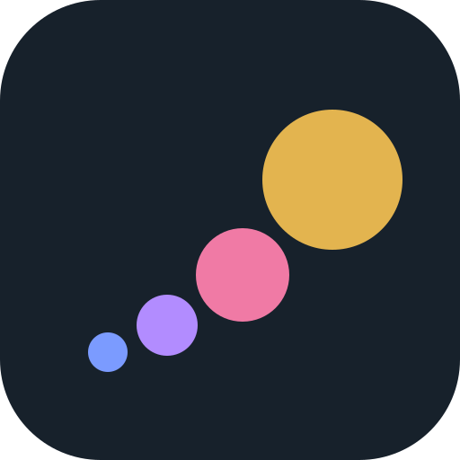

# Compound

**Grow a little every day.**

What you learn, your habits and your notes in one calm place.<br />
Small steps, done daily, add up.

[**Open Compound →**](https://compound.derenko.online) &nbsp;·&nbsp; free &nbsp;·&nbsp; installs like an app &nbsp;·&nbsp; English and Українська

<br />

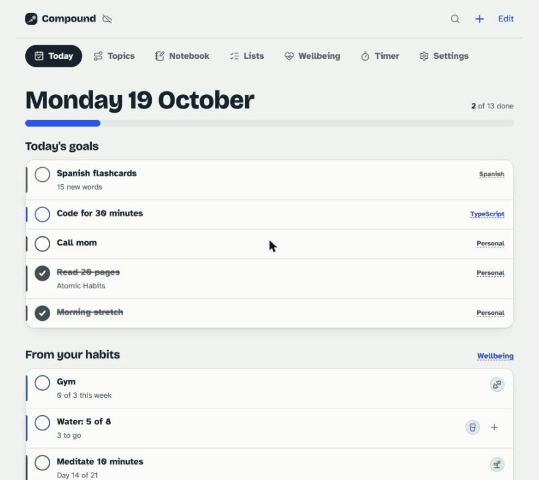

</div>

---

## ✨ Highlights

- 🎯 **One list a day.** Routines, habits and the next step of what you're learning, all on Today.
- 🔥 **Streaks that are fair.** Days with nothing due don't break them, and a missed gym day can be made up later in the week.
- 🧠 **Learning that builds itself.** Each topic suggests your next step, a project, a resource and a step to review from 7 or 30 days ago.
- 📈 **Pace you can see.** Set a goal in months and Compound tells you when you're falling behind, then adds a catch-up step.
- 🤖 **Telegram bot with AI.** Send a link or a thought and it's tagged and filed under the right topic. Ask `/ai` for a summary of any page.
- 🪄 **Claude builds your plans.** Connect Claude Code over MCP and ask for a full learning topic or a reading list.
- 🔔 **Reminders that know when to stop.** "Good morning ☀️" at your hour, a nudge in the evening, silence once you're done.
- 💧 **Habits with personality.** Gym weeks, water glasses, quit-smoking health milestones, 21-day chains and clean-day counters.
- 🎉 **Ticks feel good.** A pop and a particle burst on every tick, confetti and a fanfare when the day is complete.
- 🔍 **Search everything** with <kbd>⌘</kbd> <kbd>K</kbd>: topics, steps, notes, lists, tasks and habits.
- 🔗 **Share by link.** Send a topic or list to a friend, who can copy it into their own account in one tap.
- 📱 **A real app on your phone.** Installs to the Home Screen, opens full screen and works offline.
- 🌙 **Light and dark**, 🇬🇧 English and 🇺🇦 Українська.
- 🔒 **Yours.** No ads, no tracking. Export everything any time, or use it with no account and keep it all on your device.

## What it does

| | |
|---|---|
| ☀️ **Today** | One short list: your routines, your habits and the next step from what you're learning. A streak counts the days you finish. |
| 📚 **Topics** | Break a skill into steps. Keep resources and projects next to it, pick one topic as your focus and watch your pace. |
| 📝 **Notebook** | Notes, ideas and links. Send them to the Telegram bot and an AI files them under the right topic with tags. |
| 💚 **Wellbeing** | Gym, water, quitting smoking, any habit you build or break, and a daily mood. |
| ✅ **Lists** | Films to watch, books to read, anything you tick off, with a note on each. |
| 🔔 **Reminders** | A "Good morning" push and an evening nudge, only while something is left. Works with the app closed. |
| 🤖 **Works with AI** | A personal token lets Claude (or any MCP client) build topics and lists for you. |
| ⏱️ **Timer** | Short, long or custom focus sessions with optional background sound. |

## Screenshots

<table>
  <tr>
    <td>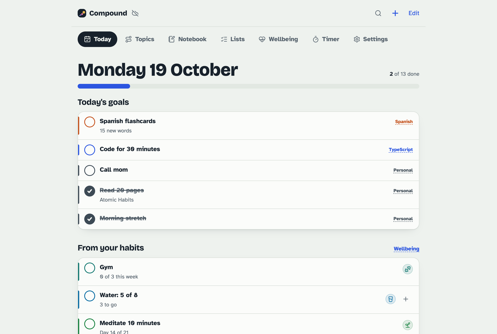</td>
    <td>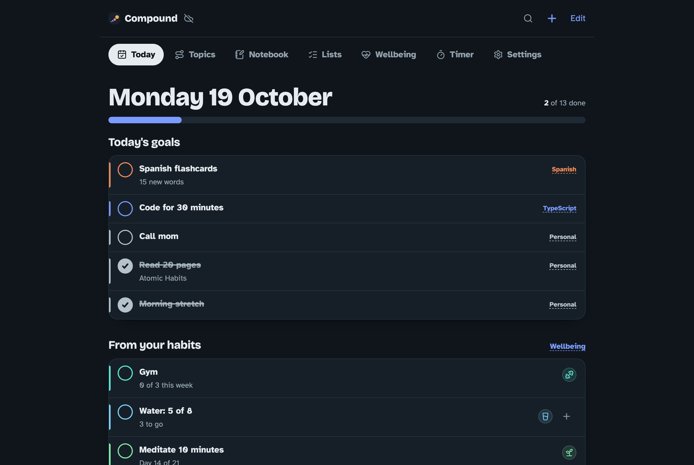</td>
  </tr>
  <tr>
    <td align="center"><sub>Today</sub></td>
    <td align="center"><sub>…and in dark mode</sub></td>
  </tr>
  <tr>
    <td>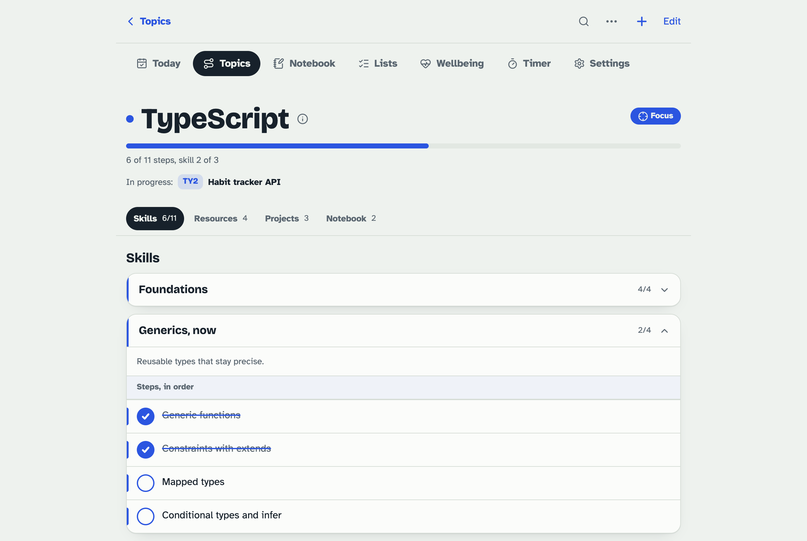</td>
    <td>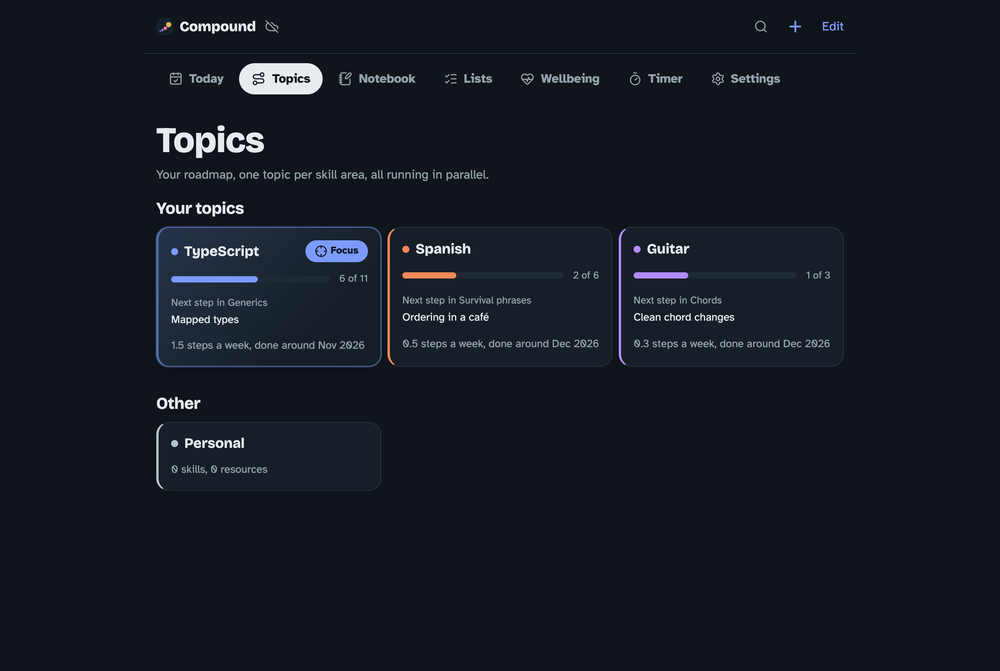</td>
  </tr>
  <tr>
    <td align="center"><sub>A topic: skills, steps, resources, projects</sub></td>
    <td align="center"><sub>Your topics and their pace</sub></td>
  </tr>
  <tr>
    <td>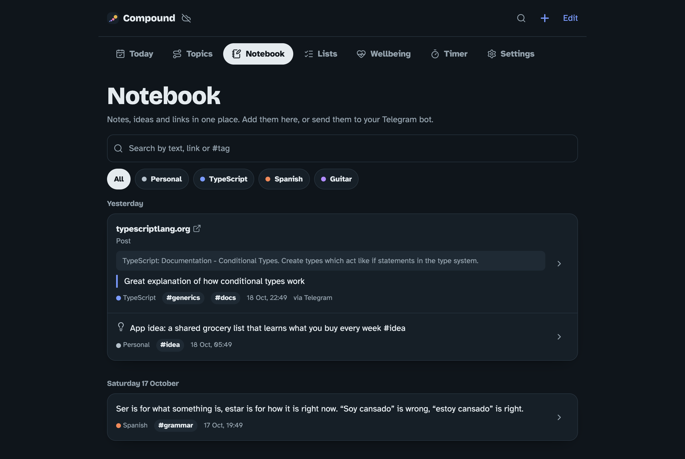</td>
    <td>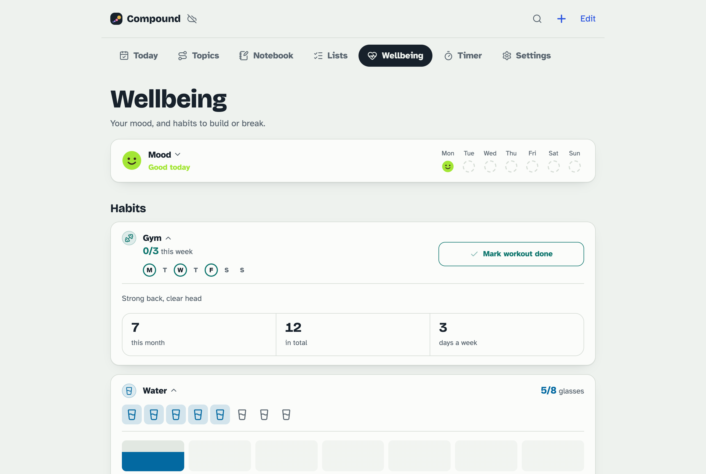</td>
  </tr>
  <tr>
    <td align="center"><sub>Notebook, fed by the Telegram bot</sub></td>
    <td align="center"><sub>Mood and habits</sub></td>
  </tr>
  <tr>
    <td>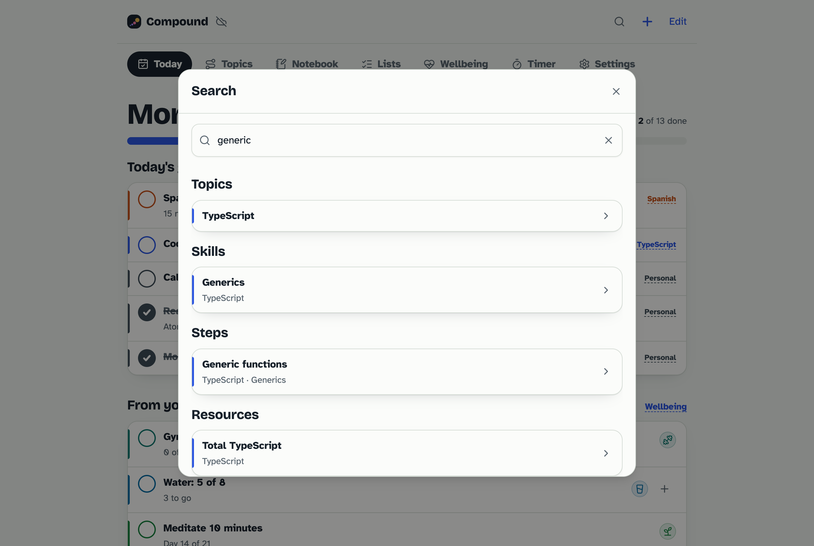</td>
    <td>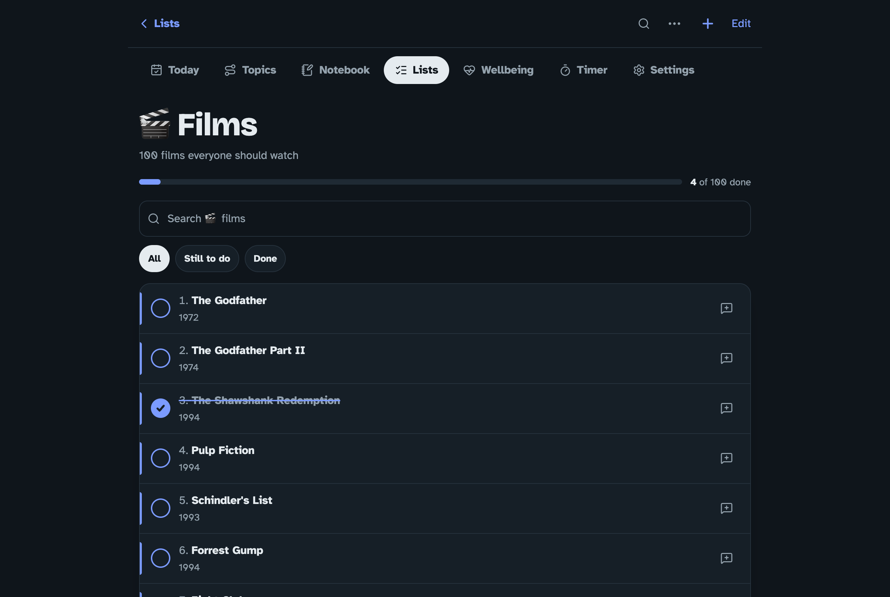</td>
  </tr>
  <tr>
    <td align="center"><sub>Search across everything</sub></td>
    <td align="center"><sub>Lists with notes on each item</sub></td>
  </tr>
</table>

<p align="center">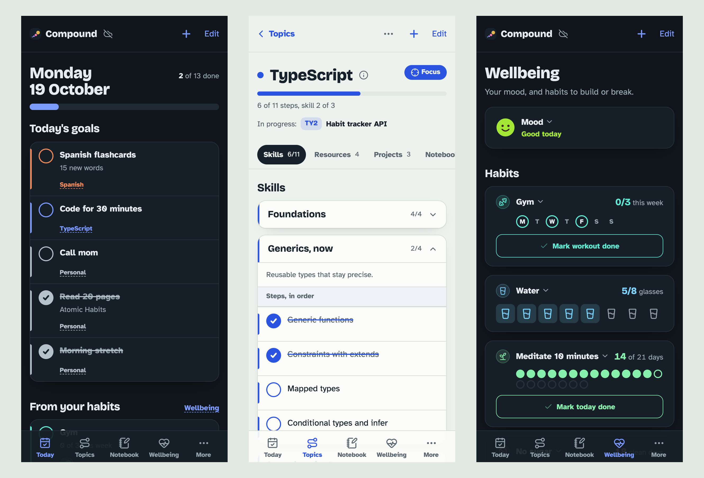</p>
<p align="center"><sub>Made for the phone first. Add it to your Home Screen and it opens full screen, offline too.</sub></p>

## How it's built

```
core/       business logic, no DOM or React: domain rules, ports, services
adapters/   Supabase, the device's local storage, Workers AI, Telegram, Web Push
worker/     Cloudflare Worker: REST API, MCP server, Telegram webhook, crons
src/        the React app (Feature-Sliced Design: app → pages → features → shared)
```

- **App:** Vite, React 19, TypeScript, TanStack Router and Query, Tailwind v4 with shadcn/ui, a PWA (vite-plugin-pwa).
- **Data:** Supabase (Postgres with row-level security, Google and email sign-in). Or no account at all: everything stays on the device.
- **Server:** one Cloudflare Worker serves the app, the API (`/api/v1`, with an OpenAPI spec), the MCP server (`/mcp`), the Telegram bot and two crons (daily cleanup, hourly reminders).
- **AI:** Workers AI (Llama 3.3 70B) tags and files what you send to the bot.
- **Push:** Web Push written on Web Crypto (VAPID and aes128gcm), no library.
- **Design system:** every page is built from shared tokens and components. Light and dark themes.

## Run it locally

```bash
npm install
npm run dev
```

Without any configuration the app runs in device-only mode: no account, data in `localStorage`.

To sync with an account, copy `.env.example` to `.env` and fill in your Supabase project:

```bash
VITE_SUPABASE_URL=https://your-project.supabase.co
VITE_SUPABASE_PUBLISHABLE_KEY=sb_publishable_...
VITE_TELEGRAM_BOT=your_bot            # optional: Settings → Connect Telegram
VITE_VAPID_PUBLIC_KEY=...             # optional: push reminders
```

Then run the migrations in `supabase/migrations` in order (`0001` to `0005`) in the Supabase SQL Editor.

| Command | |
|---|---|
| `npm run dev` | Dev server |
| `npm run build` | Type-check and build |
| `npm run lint` | oxlint plus checks for translations, import layers and comment style |
| `npx wrangler dev` | Run the worker locally |

## Deploy

Pushing to `main` builds and deploys to Cloudflare Workers. The worker needs these secrets (`npx wrangler secret put <NAME>`):

| Secret | For |
|---|---|
| `SUPABASE_SECRET_KEY` | The API, the bot and the crons |
| `TELEGRAM_BOT_TOKEN`, `TELEGRAM_WEBHOOK_SECRET` | The Telegram bot |
| `VAPID_PRIVATE_KEY` | Push reminders (make a pair with `node scripts/vapid-keys.mjs <file>`) |

`VITE_*` values are Cloudflare build variables, since Vite puts them into the app at build time.

## Connect an AI

In **Settings → AI access**, make a token and paste the prompt it gives you into Claude Code. The AI can read your topics and lists and create or change them, but never delete anything. Guidance for AIs on what a good topic looks like is in [`public/llms.txt`](public/llms.txt).

---

<p align="center">
  <a href="https://compound.derenko.online">compound.derenko.online</a> &nbsp;·&nbsp;
  <a href="https://compound.derenko.online/privacy">Privacy</a> &nbsp;·&nbsp;
  <a href="https://compound.derenko.online/terms">Terms</a>
</p>
